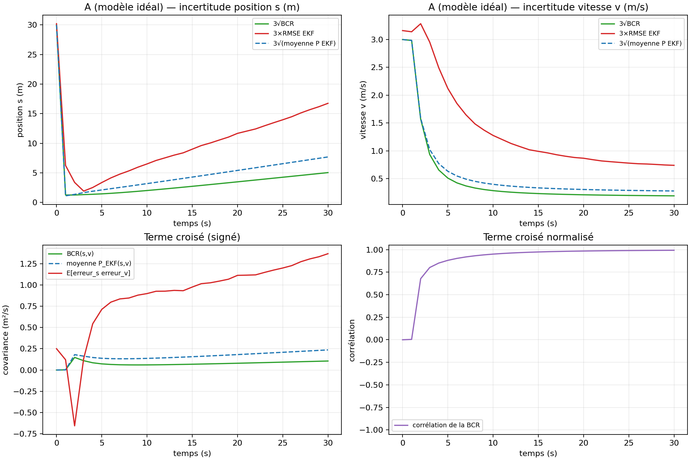
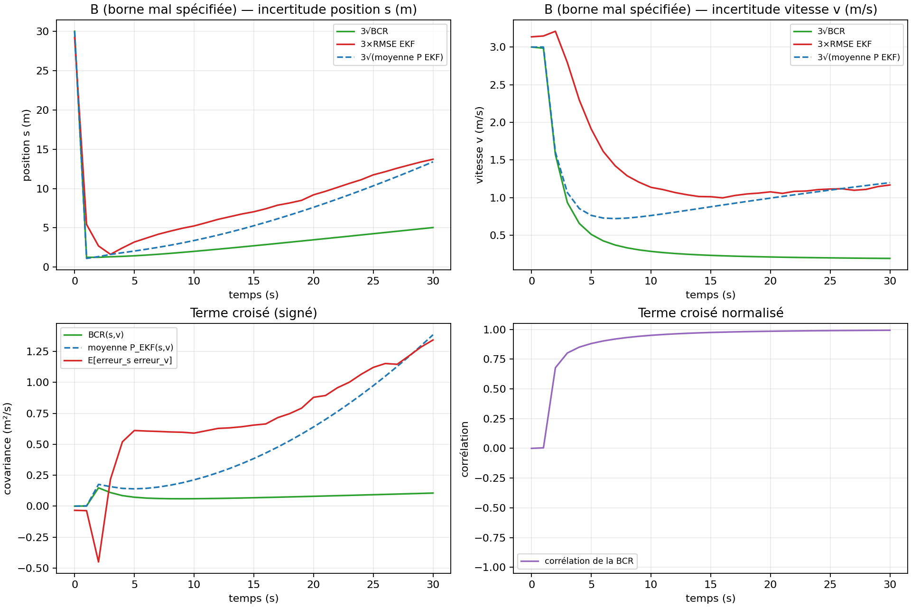
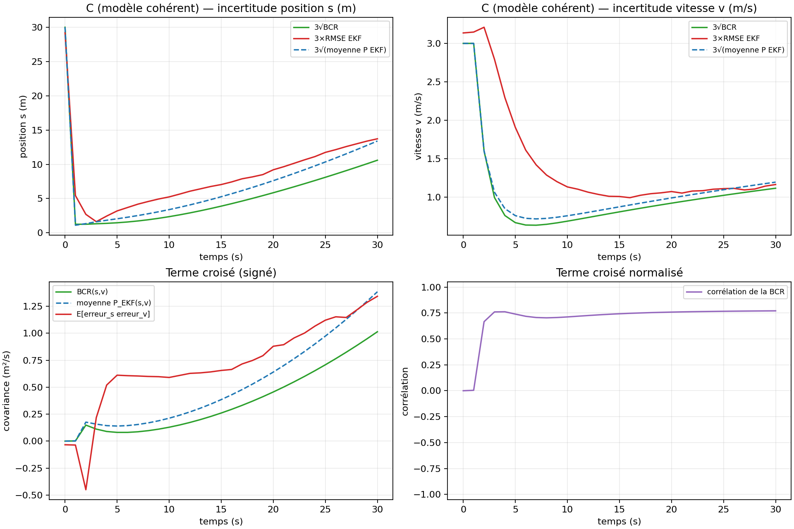
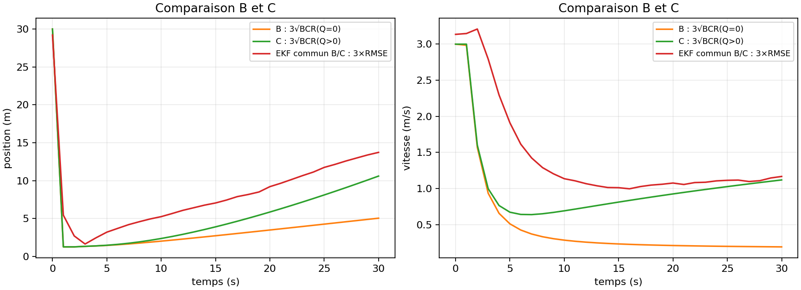

# TP3 — Cramér–Rao bounds for filtering: Questions 2a and 2b

**Code:** [`cramer_rao_general.py`](cramer_rao_general.py), [`ekf.py`](ekf.py), [`experiments.py`](experiments.py), [`tableau_q2b.py`](tableau_q2b.py)

To reproduce the figures and the table:

```bash
python experiments.py --runs 500 --mc 15000
python tableau_q2b.py --k 1 2 5 10 20 30
```

---

## 1. Problem setting

An object moves along a straight line. Its state is its position and velocity, $X_k = (s_k, v_k)^\top$, with a constant-velocity model:

$$
X_k = \Phi X_{k-1} + \eta_k, \qquad
\Phi = \begin{pmatrix} 1 & \Delta t \\ 0 & 1 \end{pmatrix}, \qquad
\eta_k \sim \mathcal N(0, Q), \qquad
Q = \begin{pmatrix} 10^{-4} & 0 \\ 0 & 10^{-2} \end{pmatrix},
$$

with $\Delta t = 1$ s and the prior $X_0 \sim \mathcal N\big((0, 5)^\top, \operatorname{diag}(100, 1)\big)$.

A sensor at $C = (0, -20)$ measures only the **bearing** of the object:

$$
z_k = \theta_k + \nu_k, \qquad \theta_k = \operatorname{atan2}(0 - y_c,\; s_k - x_c), \qquad \nu_k \sim \mathcal N\big(0, (1^\circ)^2\big).
$$

The measurement is nonlinear and only depends on $s_k$. Velocity is never observed directly. It can only be inferred from how the bearing changes over time.

---

## 2. Question 2a — Computing the BCR with process noise

### 2.1 Recursion

For linear Gaussian dynamics with a nonlinear measurement, the Fisher information matrix $J_k$ follows the recursion given in the course (Tichavský et al., 1998):

$$
\boxed{\;
J_{k+1} = \big(\Phi J_k^{-1} \Phi^\top + Q\big)^{-1} + \mathbb E_{X_{k+1}}\!\big[H_{k+1}(X_{k+1})^\top R^{-1} H_{k+1}(X_{k+1})\big],
\qquad J_0 = P_0^{-1},
\qquad \text{BCR}_k = J_k^{-1}
\;}
$$

Each step has two parts:

- **Prediction (loss of information).** $\Phi J_k^{-1} \Phi^\top + Q$ is the predicted covariance bound. Inverting it gives the predicted information. A larger $Q$ means more information is lost between two measurements.
- **Measurement (gain of information).** The new bearing adds $H^\top R^{-1} H$, averaged over the possible true states.

This is the information form of the Kalman filter. The only difference is the expectation: because $h$ is nonlinear, $H$ depends on the state, so it is averaged over the distribution of $X_{k+1}$.

**Case $Q = 0$.** The first term becomes $\Phi^{-\top} J_k \Phi^{-1}$, which is the recursion used in Q1. The code handles both cases the same way: it forms $P_{\text{pred}} = \Phi J_k^{-1} \Phi^\top + Q$ and then inverts it.

### 2.2 Jacobian of the measurement

Using the identity from the slides, $d\theta = \dfrac{-y\,dx + x\,dy}{x^2 + y^2}$ for $\theta = \operatorname{atan2}(y, x)$, with $x = s - x_c$ and $y = -y_c$ (a constant):

$$
H(X) = \begin{pmatrix} \dfrac{\partial\theta}{\partial s} & \dfrac{\partial\theta}{\partial v} \end{pmatrix}
= \begin{pmatrix} \dfrac{y_c}{(s - x_c)^2 + y_c^2} & 0 \end{pmatrix}.
$$

The information brought by one measurement is therefore

$$
H^\top R^{-1} H = \frac{y_c^2}{\sigma_\theta^2\, r^4} \begin{pmatrix} 1 & 0 \\ 0 & 0 \end{pmatrix},
\qquad r^2 = (s - x_c)^2 + y_c^2 .
$$

It decreases like $1/r^4$. Since the object moves at about 5 m/s, a bearing at $t = 30$ s is roughly $10^4$ times less informative than one at $t = 1$ s.

### 2.3 Monte Carlo computation of the expectation

The expectation has no closed form because $H$ depends on $s$ nonlinearly. It is approximated with $M$ samples:

$$
\mathbb E\big[H^\top R^{-1} H\big] \approx \frac1M \sum_{m=1}^{M} H\big(X_{k+1}^{(m)}\big)^\top R^{-1} H\big(X_{k+1}^{(m)}\big).
$$

The samples are drawn from the **prior (unconditional) distribution** of $X_{k+1}$. We draw $X_0^{(m)} \sim \mathcal N(\bar X_0, P_0)$, then propagate each sample with $X_{k+1}^{(m)} = \Phi X_k^{(m)} + \eta_k^{(m)}$, using the $Q$ assumed by the bound. They must **not** come from a filter's posterior: the BCR depends only on the model, not on a particular filter or a particular set of measurements.

In the code:

- `expected_measurement_information` computes the average above.
- `GaussianDynamicsPCRB.predict` / `update` implement the two halves of the recursion.
- `information_curve` in `experiments.py` propagates the samples ($M = 15\,000$).

The relative Monte Carlo error is about $1/\sqrt M \approx 1\,\%$, which is negligible here.

### 2.4 Sanity check at $t = 1$

Evaluate $H$ at the mean position $s_1 \approx 5$ m:

$$
|H| \approx \frac{20}{425} = 0.047\ \text{rad/m},
\qquad
\sqrt{R}/|H| \approx \frac{0.01745}{0.047} \approx 0.37\ \text{m}.
$$

This is close to the computed $\sqrt{\text{BCR}_{ss}} = 0.42$ m (Table 1). The small gap comes from averaging $H$ over the spread of $s_1$ instead of using its mean. Meanwhile $\sqrt{\text{BCR}_{vv}}$ stays at $\approx 1$ m/s, its prior value, because a single bearing contains no velocity information.

---

## 3. Question 2b — Comparison of the BCR and the EKF

### 3.1 Protocol

The same EKF ([`ekf.py`](ekf.py), Joseph-form update with angle wrapping) is run on $N = 500$ simulated trajectories over 30 s. Three cases are compared:

| Case | Truth | EKF | BCR | Question |
|---|---|---|---|---|
| **A** | $Q = 0$ | $Q = 0$ | $Q = 0$ | Q2b-(1) |
| **B** | $Q \ne 0$ | $Q \ne 0$ | $Q = 0$ | Q2b-(2) |
| **C** | $Q \ne 0$ | $Q \ne 0$ | $Q \ne 0$ | Q2b-(3) |

B and C use exactly the same trajectories and EKF runs; only the bound changes.

Three quantities are plotted, all as $3\sigma$ curves, for each state component $i \in \{s, v\}$:

| Name | Formula | Meaning |
|---|---|---|
| BCR | $3\sqrt{(J_k^{-1})_{ii}}$ | best achievable error (theory) |
| EKF | $3\sqrt{\mathbb E[P^{\text{EKF}}_{k,ii}]}$ | error the filter **claims** |
| RMSE | $3\sqrt{\mathbb E[(\hat X_{k,i} - X_{k,i})^2]}$ | error the filter **actually makes** |

Two properties are assessed:

- **Consistency:** RMSE ≈ EKF, meaning the filter knows how good it is.
- **Efficiency:** RMSE ≈ BCR, meaning the filter is close to optimal.

### 3.2 Results

**Table 1:** standard deviations (1σ; the figures show 3σ). Position $s$ in m, velocity $v$ in m/s. 500 runs, $M = 15\,000$.

| Case | $k$ | BCR $s$ | BCR $v$ | EKF $s$ | EKF $v$ | RMSE $s$ | RMSE $v$ |
|---|---|---|---|---|---|---|---|
| A | 1  | 0.42 | 0.99  | 0.37 | 0.99  | 2.08 | 1.05 |
| A | 5  | 0.48 | 0.17  | 0.70 | 0.21  | 1.12 | 0.71 |
| A | 10 | 0.67 | 0.095 | 1.06 | 0.13  | 2.17 | 0.43 |
| A | 30 | 1.68 | 0.063 | 2.56 | 0.093 | 5.58 | 0.25 |
| B | 1  | 0.42 | 0.99  | 0.37 | 1.00  | 1.81 | 1.05 |
| B | 5  | 0.48 | 0.17  | 0.68 | 0.25  | 1.07 | 0.64 |
| B | 10 | 0.67 | 0.095 | 1.13 | 0.25  | 1.75 | 0.38 |
| B | 30 | 1.68 | 0.063 | 4.47 | 0.40  | 4.58 | 0.39 |
| C | 1  | 0.42 | 1.00  | 0.37 | 1.00  | 1.81 | 1.05 |
| C | 5  | 0.49 | 0.22  | 0.68 | 0.25  | 1.07 | 0.64 |
| C | 10 | 0.79 | 0.23  | 1.13 | 0.25  | 1.75 | 0.38 |
| C | 30 | 3.53 | 0.37  | 4.47 | 0.40  | 4.58 | 0.39 |

**Ratios at $k = 30$**

| Case | RMSE/EKF ($s$) | RMSE/EKF ($v$) | RMSE/BCR ($s$) | RMSE/BCR ($v$) |
|---|---|---|---|---|
| A | 2.2 | 2.6 | 3.3 | 3.9 |
| B | 1.0 | 1.0 | 2.7 | 6.2 |
| C | 1.0 | 1.0 | 1.3 | 1.04 |

### 3.3 Case A — no process noise anywhere (Q2b-1)



- **The BCR behaves as expected for deterministic dynamics.** The position bound first drops to 0.4 m, while the object is close to the sensor. It then grows slowly, because the bearings bring less and less information. The velocity bound keeps decreasing, since each new bearing refines the estimate of the velocity, which is constant.
- **The EKF is not consistent.** Its actual error is 2 to 3 times larger than the covariance it reports. It is also far from the bound: about 3.3× for position and 3.9× for velocity at $k = 30$.
- **Explanation:**
  1. *Linearisation error at the first update.* The initial position uncertainty (σ = 10 m) is of the same order as the distance to the sensor (20 m). Over such a range, $\operatorname{atan2}$ is strongly nonlinear, so the EKF's Jacobian $H(\hat X^-)$ is a poor approximation, and the first correction is biased. This shows up as a large RMSE at $k = 1$: 2.1 m against a bound of 0.4 m.
  2. *No mechanism to recover.* With $Q = 0$, $P_k$ only decreases, so the gain $K_k \to 0$. The filter trusts its (wrong) estimate more and more and gives little weight to new measurements. The initial error is then carried forward by the dynamics, and $e_s \approx e_s^{(0)} + t\, e_v$ grows linearly in time.

### 3.4 Case B — process noise in the truth and the EKF, not in the BCR (Q2b-2)



- **The EKF is now consistent:** RMSE ≈ EKF for both components ($4.58$ vs $4.47$ m and $0.39$ vs $0.40$ m/s at $k = 30$). With $Q > 0$, the predicted covariance stays away from zero. The gain therefore remains significant, and the filter keeps correcting itself with new measurements: the initial linearisation error is forgotten.
- **The bound is mis-specified.** It is the same curve as in case A, because it ignores the process noise. It is 2.7× below the RMSE in position and 6.2× below in velocity.
- **This curve is not a valid bound for this problem.** The Cramér–Rao inequality only holds for the model used to compute $J_k$. Here the data come from a model with $Q \ne 0$, so this "bound" does not describe the best achievable performance. It only shows what would be possible *if* the object had no random accelerations. Concluding that the EKF is far from optimal would be wrong.

### 3.5 Case C — same process noise everywhere (Q2b-3)



- **The three curves are in the expected order:** $\text{BCR} \le \text{RMSE} \approx \text{EKF}$.
- **The bound now grows with time for both components.** Each step adds the uncertainty $Q$, while the information from the bearings decreases like $1/r^4$. Process noise ends up dominating, and the achievable accuracy degrades.
- **The EKF is close to efficient.** At $k = 30$ its velocity RMSE is only 4 % above the bound, and its position RMSE is 30 % above. The larger gap at the start ($t < 15$ s) is again the cost of the nonlinear first updates. The bound does not pay this cost, because it evaluates $H$ at the true states.
- **Remark on the first instant:** at $k = 1$ the EKF claims 0.37 m, slightly *below* the BCR (0.42 m). This does not contradict the theory: the bound applies to the **true error** (RMSE = 1.81 m), not to the covariance computed by the filter, which is only an approximation.

### 3.6 Comparison of cases B and C



The two bounds coincide for the first ≈ 5 s. During that time the measurements are very informative and little process noise has accumulated. After that they diverge: at $k = 30$, the correct bound (C) is 2.1× larger in position and 5.9× larger in velocity than the mis-specified one (B). **Ignoring $Q$ in the bound strongly overestimates the achievable performance**, especially for velocity, which is the component directly driven by the noise.

---

## 4. Conclusion

- **Q2a.** The BCR with process noise is computed recursively from the model alone: the prior $P_0$, the dynamics $(\Phi, Q)$ and the measurement $(h, R)$. A Monte Carlo average handles the nonlinear measurement. Because it needs no measurement data, it can be computed *before* any experiment, for example to size a system.
- **Q2b.** Comparing the three curves answers two separate questions:
  - *Is the filter consistent?* Compare the RMSE with the covariance the EKF reports. The EKF is inconsistent in A and consistent in B and C.
  - *Is the filter efficient?* Compare the RMSE with the BCR. This comparison is only meaningful when the bound uses the true model, as in C. There, the EKF is close to efficient once the initial transient is over.
- **Main lessons.**
  1. A Cramér–Rao bound is only valid for the model it was computed with (case B).
  2. A small amount of process noise in the filter makes the EKF more robust: it keeps the gain open and lets the filter recover from linearisation errors (A vs B).
  3. In bearings-only tracking, the geometry limits the achievable accuracy. The information decays like $1/r^4$ as the object moves away from the sensor.

**Limitation.** The BCR is a local bound, based on the curvature of the likelihood. It is tight when the signal-to-noise ratio is high, but it can be optimistic when the posterior is spread out or multimodal. That is the case here at the first time step, where the prior uncertainty is comparable to the distance to the sensor. Global bounds such as the Ziv–Zakai bound would be better suited to that regime.
